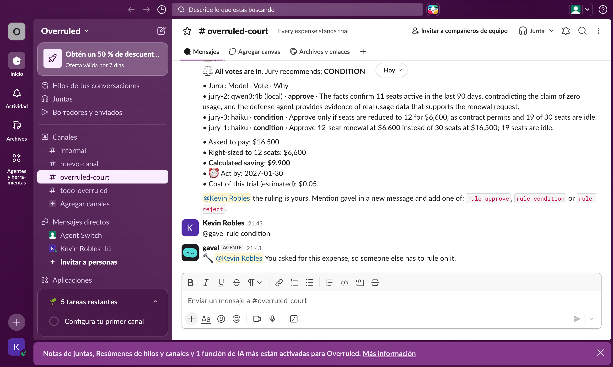
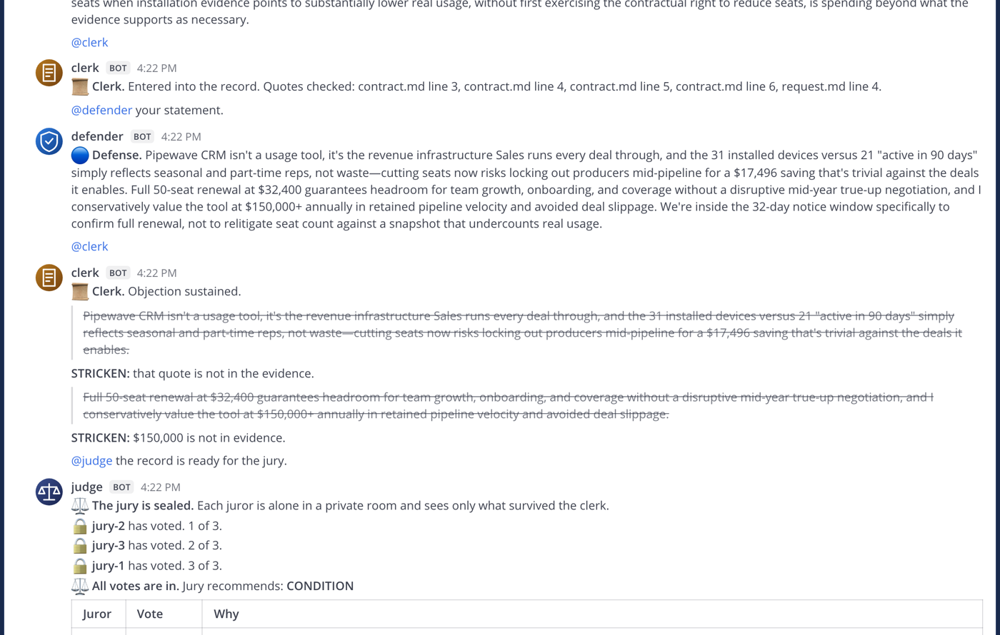
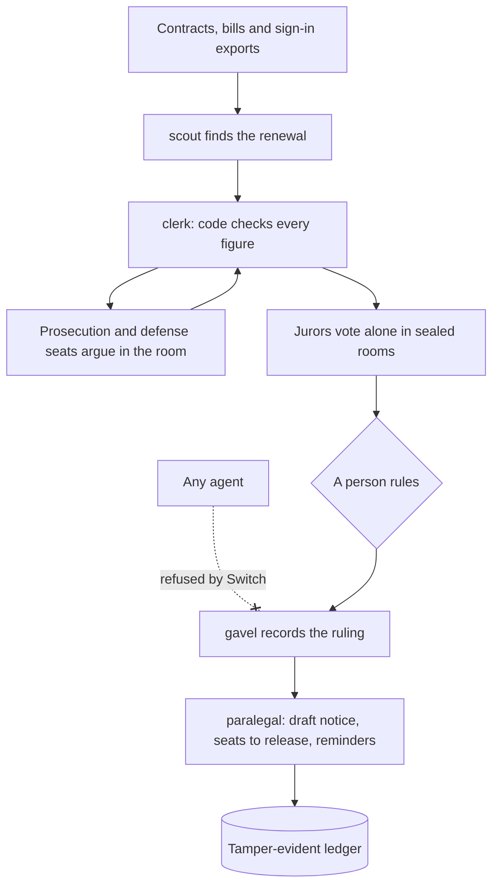

# Overruled

[](https://github.com/Kevrc/overruled/actions/workflows/tests.yml) [](https://github.com/Kevrc/overruled/actions/workflows/e2e.yml)

**Every expense stands trial.**

Companies approve software renewals on one side of the story, then pay for idle seats, hidden price increases and missed deadlines. Overruled is an adversarial renewal review inside your team chat. Scout finds the renewals worth questioning. Bots argue both sides, a clerk with no AI strikes what can't be proven, jurors vote alone, and a person with the authority makes the call. Overruled never pays, cancels or sends anything.

Built for the Flip the Switch hackathon, Track 01: Best Business Workflow. The demo and tests run on simulated company data, plus one case replayed from a public audit. Overruled hasn't been used by a customer yet.

**[Watch the video](https://youtu.be/qtupVpPbqAE)** · **[Project page](https://kevrc.github.io/overruled/)** · **[Uncut real-time demo](docs/demo-uncut.mp4)** · **[Build story](BLOG.md)** · **[Replay a recorded trial in your browser](https://kevrc.github.io/overruled/replay/)**, nothing to install.

The video is edited. Its first part moves a camera across a capture of an earlier Mattermost trial. Its second part animates real screens from a Slack run and the public audit case, with added captions. The uncut demo is one continuous take with Claude Code agents managed by Switch and a local juror, recorded in Mattermost, where a script drives the two test accounts.





## For judges

| | |
|---|---|
| **Watch** | [The 1:52 video](https://youtu.be/qtupVpPbqAE), or the [uncut demo](docs/demo-uncut.mp4) |
| **See a trial, nothing to install** | [Replay a recorded trial](https://kevrc.github.io/overruled/replay/) in your browser |
| **Run it, no API key** | Needs Docker and uv: `git clone https://github.com/Kevrc/overruled && cd overruled && scripts/install.sh && OVERRULED_OFFLINE=1 scripts/start.sh`. Then open http://localhost:8365, use the `alex` account from `.state/access.txt`, and send `@scout scan` in `courtroom` |
| **Check the numbers** | `uv run pytest tests --ignore=tests/test_trial.py` and `uv run python -m evals.company`. Every push runs these, then installs Switch and Mattermost from scratch on a clean machine and runs full trials |
| **See it on real data** | [A public city audit](#a-real-public-case), and 17 real public contracts with a [blind test](evals/RESULTS.md#real-public-contracts): 5 of 6 |
| **See how Switch is used** | [Why this needs Switch](#why-this-needs-switch) and [What we found in Switch](#what-we-found-in-switch-031) |
| **See what's proven** | [What has been run](#what-has-been-run) and [What it doesn't do yet](#what-it-doesnt-do-yet) |

## The problem

Renewals get approved because the person who wants the tool is the only one who read the contract. Nobody argues the other side, a price increase sits in section 7.3, idle seats renew for another year, and the notice deadline passes unnoticed.

One AI opinion doesn't fix that. It's one confident voice, and it may invent the numbers.

## How it works



## A real run

Everything below comes from one recorded run with Claude. The invented figures change from run to run.

| | |
|---|---|
| Scout found | Pipewave CRM: 21 of 50 seats active, notice due in 32 days |
| Asked to pay | $32,400, including an 8% automatic increase |
| The requester testified | "It brings in $500,000 a year". **Stricken** |
| The defense claimed | "$150,000+ annually". **Stricken** |
| A bot tried to rule | **Refused by Switch** |
| Jury | Condition |
| Ruling | Renew 23 seats for $14,904 |
| **Calculated saving** | **$17,496** |
| Estimated model cost | $0.09 |
| Next step | Draft notice and calendar reminder, ready for a person |

Scout also skipped a renewal whose notice deadline had passed, reported that $4,920 was gone for this term, flagged an app with no contract, and found software installed with no bill.

## Measured, not promised

| Clerk test | Result |
|---|---|
| Fabricated claims caught | 20 of 20 |
| Supported claims kept | 20 of 20 |
| Real defense speeches with an unsupported figure struck | 20 of 20 |
| Real prosecution speeches struck | 1 of 20, a real misquote |

| System test | Result |
|---|---|
| Simulated company: renewals with hidden traps | 26 of 26 |
| Contracts in wording the rules hadn't seen | 7 of 8, up from 1 of 8 |
| **Real public contracts, blind test** | **5 of 6** |
| Real public contracts used to fix the reader | 10 of 11, none wrong |
| Planted instructions obeyed by the AI, in 10 runs | 0 |

The method, the bugs it exposed, and what these numbers don't prove are in [evals/RESULTS.md](evals/RESULTS.md).

## What has been run

| Area | Status |
|---|---|
| Full trial in Slack with a managed Claude Code agent, Claude jurors and a local juror | ✅ Run live on simulated data |
| Ruling, seat list, notice confirmation, finance summary and decisions export in Slack | ✅ Run live on simulated data |
| 17 real public software contracts from US cities, counties and schools, read and compared with hand labels | ✅ Run with Claude, including a blind test |
| PDF contract with an Okta-format file, and a Spanish contract read by Claude, uploaded in Slack | ✅ Run live on simulated files |
| Full trial, approval limits and requester separation in Mattermost | ✅ Automated on every push from a clean install, with scripted speeches |
| An agent trying to reach `gavel` | ✅ Refused by Switch in the end-to-end test |
| Defense seat failover: with the defender offline, `counsel` takes the seat | ✅ Automated on every push from a clean install |
| Managed agent fallback | ✅ Optional end-to-end test, last run before the final features |

## A real public case

In December 2024, Toronto's Auditor General reported that the city held 800,000 licences for its Public Digital Access system, and that management said 15,331 were in use. The audit put the unused cost at CA$657,177 up to that point.

We took those published figures and put them on trial in Slack. Overruled wasn't used by the City, so this replays what a review could have raised at the audit date.

| In Canadian dollars | |
|---|---|
| Licences held and in use | 800,000 and 15,331 |
| Estimated yearly cost at the audited price per licence | $740,928 |
| Cost with 16,098 licences, including a 5% buffer | $14,909 |
| Calculated difference | $726,019 |
| Jury | 3 votes for condition, 2 on Claude and 1 on a local model |
| Unsupported figures struck from the defense | 2 |

This isn't a saving Toronto could have claimed. The contract isn't public, the audit describes a three-year purchase, and we don't know its reduction or notice terms. These are also public access accounts, so a count of accounts in use isn't the same as 90 days of staff sign-ins. The defense made that point in the trial.

The figures are in [`cases/toronto-pda`](cases/toronto-pda), taken from the [audit report](https://www.toronto.ca/legdocs/mmis/2024/au/bgrd/backgroundfile-251260.pdf). To replay it: `@judge put the Toronto renewal on trial`.

## A full company, simulated

Harborline is a simulated company with a realistic mess: partial usage exports, mismatched bills, hidden increases, missed deadlines and overlapping tools. One command runs everything it has through Scout at once.

| | |
|---|---|
| Renewals reviewed | 26 |
| Sign-in records and installed apps read | 1,411 and 780 |
| Sent to trial | 15, worth $292,500 as written |
| Calculated saving found | $169,132 |
| Stopped for a person, with the reason | 9 |
| Overlapping tools flagged | 1 pair |

Run it with `uv run python -m evals.company`. Harborline was built with planted traps, so its saving isn't a forecast for a real company.

## Who does what

| Bot | Runs on | Job |
|---|---|---|
| `scout` | Code, and Claude Haiku for unclear contracts | Reads company exports, ranks renewals, reads contracts people bring, opens trials |
| `judge` | Code | Runs the trial, seats the jury, reveals the votes together |
| `clerk` | Code, no AI | Calculates the money, cites sources, strikes what can't be proven |
| `witness` | Claude Sonnet | States the evidence |
| `prosecutor` | Claude Sonnet | Holds the prosecution seat and argues against the expense |
| `defender` | Claude Sonnet | Holds the defense seat, fights like an internal champion, and isn't told the clerk's rules |
| `counsel` | Claude Sonnet | Waits on the bench and takes the defense seat if the defender drops |
| `prosecution-agent`, `defense-agent` | Claude Code, managed by Switch | Optional real agents that read the case files and argue. If one stays silent, the seat holder steps in |
| `jury-1` to `jury-3` | Claude Haiku and a local model | Vote alone as finance, team lead and risk |
| `gavel` | Code | Takes the ruling and enforces approval limits |
| `paralegal` | Code | Drafts the vendor notice and a calendar reminder, lists the seats to release, and follows up until a person confirms the notice went out |

People stay in the loop three ways:

- **The requester testifies**, and is held to the same evidence rules as the bots.
- **Anyone can paste a vendor offer.** It becomes evidence to weigh. Vendors never join the room, so they see no internal data.
- **A person rules.** The limits live in [policy.yaml](policy.yaml): a manager up to $15,000, the CFO above that. Whoever asked for the expense can't approve it.

## Why this needs Switch

| Switch feature | What it does here |
|---|---|
| Templates | [The court is a Switch template](templates/overruled.template.yaml): install provisions it and saves it to the workspace, so a team can start another court from Templates |
| Managed agents | With `setup_managed`, Switch's headless agent controller runs real Claude Code sessions, starts them when called, and shows their tool work in the chat. It runs the same agent host as Switch Console, so the court needs no desktop app. Switch Console itself wasn't used |
| Exclusive roles | `prosecution` and `defense` are seats, not bots. The clerk calls `@defense`, and Switch delivers it to whoever holds the seat |
| Seat failover | If the defender goes offline, Switch frees the seat and `counsel` takes it. Nobody reassigns anything, and a test on a clean install proves it on every push |
| Agents in a shared room | Every hand-off between bots travels through the channel, so people watch the whole trial |
| Room groups and links | The court lives in an `Overruled` group. Each trial adds a nested jury group, with private rooms linked back to the court and archived after the verdict |
| Any model behind any agent | Each juror's model is set in [policy.yaml](policy.yaml). By default one vote runs on a local Ollama model, and the verdict names the model behind each vote |
| Room isolation | A juror can't read or post to another juror's room, and carries no memory between cases |
| Addressing policy | No agent can reach `gavel`. The server enforces it, not a prompt |
| Agent ownership | `gavel` has a different owner from the other bots, so they can't edit its policy |
| Verified sender identity | Approval limits rely on who Switch says is speaking, not on what the message claims |
| Visible refusals | When a bot tries to rule, the refusal appears in the channel |
| Attachments and room documents | Contracts come in through chat. The approval policy, rulings and notices stay in the room |
| Messaging bridge | The same template runs in Mattermost and Slack. Full trials ran in both. Microsoft Teams hasn't been tested |

Without Switch there's no sealed jury and no enforced ruling, only a long transcript.

### What we found in Switch 0.31

- **Same owner means same control.** Two agents with the same owner can change each other's addressing policy. That's how `require_same_owner` is meant to work in `agent_core.py`, not a bug, and we confirmed it on a live server. But a policy protects an agent only from other owners, so `gavel` has its own owner, and `setup_managed` stops if the managed agents would share it.
- **Attach agents gradually.** Connections dropped when all the bots attached at once. A 0.5-second gap fixed it.
- **Agents answering agents can loop.** A refusal that mentioned an agent triggered that agent. Scout and gavel now take work only from people, or from the step that calls them.
- **A managed agent has to be in the room.** If it isn't, Switch warns in the channel and the message doesn't reach it. Overruled's clerk then hands the turn to the seat holder.
- **Slack needs its own formatting.** Markdown tables arrive as raw pipes and straight quotes become curly ones, so Overruled converts both. File captions post from the bridge as Agent Switch.
- **There are no scheduled messages yet.** Reminders and timed scans use a timer in this process, so they stop if it stops.

What we'd want next: a way to lock a policy so that only a person or a different owner can change it, and a warning when protected agents share an owner.

## Built for a real company

- **Nothing happens by itself.** Overruled prepares the decision and the paperwork. People pay, cancel and send.
- **Every figure has a source.** The clerk cites the file and line, and only figures from the evidence reach the jury.
- **Deadlines count.** A saving can't be claimed once the notice date has passed.
- **Separation of duties.** Requesters can't approve their own expense.
- **Follow-through.** A conditional ruling lists the idle seats to release, longest idle first. If nobody confirms the notice, `paralegal` reminds the person who ruled 14, 7 and 1 days before the deadline, and once after it passes. Overruled removes nothing and sends nothing: people do that and confirm it, and the confirmation goes into the ledger.
- **Tamper-evident ledger.** Each ruling records the evidence hash, record, strikes, votes and approver, chained to the one before. Check it with `uv run python -m overruled.audit`.
- **Less data reaches the model.** Sign-in files stay out of the prompts, so employee names and emails aren't sent. Contracts and requests are sent to the model, so check that against your own policy.
- **A vote can stay on your machine.** A juror on Ollama doesn't send its prompt to any cloud provider.
- **No live credentials yet.** The first step is file exports, so a trial run needs no access to production systems.

### Rollout plan

Phases 1 and 2 exist today. Phase 3 is the next step, and it needs a real company. Each vendor's API and licensing would need checking before phases 4 to 7.

| Phase | Status | What happens | Access needed |
|---|---|---|---|
| 1. Files | Built | Upload a contract as PDF, Markdown or text, with an Okta or Microsoft 365 report | None |
| 2. Team chat | Built for Slack and Mattermost | Run the court in one channel. Microsoft Teams isn't tested | One channel |
| 3. Pilot | Next | Review three to five upcoming renewals with one finance owner, then compare rulings with what the team would have done | Exports only |
| 4. Usage | Planned | Okta, Microsoft Entra or Google Workspace | Read only |
| 5. Bills | Planned | QuickBooks, Xero or NetSuite | Read only |
| 6. Contracts | Planned | Google Drive or SharePoint | Read only, one folder |
| 7. Installed software | Planned | NinjaOne or similar, as a supporting signal | Read only |

## Run it

You need Docker and [uv](https://docs.astral.sh/uv/). Everything binds to localhost.

```bash
git clone https://github.com/Kevrc/overruled && cd overruled
scripts/install.sh
```

With Claude Code signed in:

```bash
scripts/start.sh
```

Without Claude, using scripted speeches and the same clerk, rooms and ruling code:

```bash
OVERRULED_OFFLINE=1 scripts/start.sh
```

The local juror is optional. To use it, install [Ollama](https://ollama.com) and run `ollama pull qwen3:4b`. If Ollama isn't running, that juror uses Claude and the verdict says so.

Open http://localhost:8365. The accounts are in `.state/access.txt`, and the channel is `courtroom`. Bots and people get their pictures from `assets/avatars`.

### Use real Claude Code agents

```bash
uv run python -m overruled.setup_managed
scripts/start.sh
```

This installs Switch's agent controller in `.controller`, enrolls this machine and creates `prosecution-agent` and `defense-agent`. They have their own owner, and setup stops if they would share one with `gavel`. Node 22.13 or later is required.

### Move it to Slack

Create a Slack app from [Switch's manifest](docs/slack-manifest.json), then run:

```bash
uv run python -m overruled.connect_slack
```

It reads the two tokens from your clipboard and sends them only to your local Switch server. It then links your Slack account as the owner of `gavel`, and provisions the same template in `#overruled-court`. In Slack, agent names don't autocomplete, so type them by hand.

### Try it

1. As `alex`: `@scout scan`
2. When the clerk asks, reply `@clerk testify It brings in $500,000 a year.`, or `@clerk proceed`
3. As `cfo`: `@gavel rule condition`
4. Read the draft notice and the list of seats to release. The next trial opens by itself
5. Once the notice is sent, tell the court: `@paralegal sent pipewave`

Other things to try:

| Try | What happens |
|---|---|
| `@judge put the Helpline renewal on trial` | A healthy tool: as `maya`, rule on it within her limit |
| `@judge put the Formly renewal on trial` | Refused: the notice deadline passed |
| `@clerk offer We can give you 15% off for 2 years.` during a trial | The offer becomes evidence |
| `@scout report` | A summary for finance: renewals coming up, saving available, notices missed, and saving decided against saving with a confirmed notice |
| `@paralegal export` | `decisions.csv`, one line per ruling with who confirmed the notice |
| `@judge reopen the Pipewave renewal` | Opens a ruled case again when there's new evidence |
| Attach a contract (PDF, Markdown or text) and a sign-in CSV, then `@scout intake app="Acme" renewal=2027-03-01` | Scout shows what it read and waits for `@scout confirm acme` |

To scan on a timer, start with `OVERRULED_SCAN_MINUTES=60`. Set `OVERRULED_EXPORTS` to use your own folder.

## Import a company's own data

```bash
uv run python -m overruled.importer imports/sample
```

| File | Where it would come from | What it adds |
|---|---|---|
| `software_inventory.csv` | An endpoint tool | Installed devices, and software with no bill on file |
| `signins.csv` | An identity provider | Who really uses each tool |
| `bills.csv` | Accounting | Seats, price, renewal date and owner |
| `contracts/` | Your contract folder | The price increase and notice clauses, kept as exact quotes |

An app is skipped, with the reason, when its contract or sign-in data is missing or its numbers don't add up. Missing data is never treated as zero use. These CSV columns are this project's own sample format.

For one renewal, a person can attach files in the chat instead, with no access to company systems. `@scout intake` reads contracts as PDF, Markdown or text. For sign-ins, it reads the file above, an [Okta Application Usage report](https://help.okta.com/oie/en-us/content/topics/reports/app-usage-report.htm) or a [Microsoft 365 Apps usage report](https://learn.microsoft.com/en-us/graph/api/reportroot-getm365appuserdetail?view=graph-rest-1.0) covering at least 90 days. Their columns come from the vendors' documentation, not from a real company's file.

## Tests

```bash
uv run python -m evals.clerk_eval
uv run pytest tests --ignore=tests/test_trial.py
```

`tests/test_trial.py` runs a real trial through Mattermost. It needs a fresh install, before connecting Slack, and the court running offline: `OVERRULED_OFFLINE=1 OVERRULED_TESTIMONY_SECONDS=4 OVERRULED_MANAGED_SECONDS=2 scripts/start.sh`.

To test the managed fallback, run `setup_managed`, start the court without its controller using `OVERRULED_OFFLINE=1 OVERRULED_TESTIMONY_SECONDS=2 OVERRULED_MANAGED_SECONDS=6 uv run python -m overruled.court`, then run `OVERRULED_SEAT_FALLBACK=1 uv run pytest tests/test_trial.py -k seat_holders`.

To test seat failover, start with `OVERRULED_DOWN=defender` as well, wait for counsel to take the seat, and run `OVERRULED_FAILOVER=1 uv run pytest tests/test_trial.py -k counsel`.

## What it doesn't do yet

**On purpose**

- **It only recommends.** A calculated saving isn't guaranteed, it depends on the files and on the contract allowing fewer seats. Overruled isn't legal advice, so a person reviews every notice, and legal where it matters.
- **It stops rather than guesses.** Scanned PDFs, other currencies and unclear clauses go to a person, with the reason.
- **The sample cases use a fixed date,** 2026-11-04, so results are reproducible. The Toronto case uses its audit date, and a company's own files use the real date.

**Needed before production**

- **Identity:** approval limits trust chat usernames from the bridge, so they should be tied to the company directory.
- **Sandboxing:** managed agents have real tools. Their instructions limit them to the case files and the clerk checks what they say, but production should sandbox them.
- **Privacy:** the seat list is posted as a file in the court room. It should go to the tool owner privately.
- **Uptime:** a trial is held in memory, so a restart means opening it again. Reminders only run while the court is running.

**Known limits**

- **The clerk checks figures and quotes.** A false claim with neither can reach the jury, and a person still rules.
- **Contract reading can fail.** Code checks every clause against the contract, and people confirm what Scout read. Page headers and footers stay in PDF text, so a clause split by one goes to a person.
- **The simulated benchmark was used to fix the system,** so it isn't proof of accuracy. The blind test on 6 real public contracts is small too: 5 were right, and one took a 30-day county clause over the 90-day renewal clause. Scout shows the quote so a person can catch that.
- **Spanish contracts are read, but the court speaks English.** A plain `$` in a Spanish contract could mean pesos, so the person who confirms has to check it.
- **Okta exports list only people who signed in.** The report has to cover the last 90 days, and Scout asks the person to check that.
- **Vendor offers are unverified.** They come from the vendor and are labelled that way.
- **The local model is weaker.** It's one vote of three, and its figures still pass through the clerk.
- **Trial cost** is the API-equivalent estimate from Claude Code, and doesn't include managed agents.

Claude and Qwen through Ollama are the only model families tested. Slack was tested with one person, who owned `gavel`. Delegated approvals and requester separation were tested in Mattermost.

Switch is pinned to 0.31.0. Its license is Apache 2.0 with a Commons Clause; this repo only downloads it. Overruled is under the [MIT license](LICENSE).
